# Week 11 · Let Tweets Speak

### Large Language Models + Twitter Data

<div class="hero"><div><span class="eyebrow">IA 340 · MONDAY · NOV 2</span><h2>Let an LLM read the text.</h2><p>From MongoDB queries to text analysis: sentiment, named people, translation, and summary.</p><div class="pillbar"><span>Gemini LLM API</span><span>Lab 8 tweets</span><span>MongoDB</span><span>pandas</span><span>Python charts</span></div></div><div class="tweet-stack"><div class="tiny-tweet">“The bus arrived early!” <b>🙂</b></div><div class="tiny-tweet">“I waited an hour.” <b>🙁</b></div><div class="tiny-tweet">“What do the messages mean?” <b>?</b></div></div></div>

**Today:** Understand the LLM → optional Google Sheets activity → Gemini API + MongoDB + Python hands-on.

---

## 01 · From numeric queries to text meaning

Previously, we used **quantitative queries** to count, filter, sort, and compare data: likes, hashtags, followers, and locations.

LLMs can also **read text** and generate new fields that we could not easily compute with an ordinary numeric query.

<div class="two-cards"><div class="lesson-card mint"><h3>Structured or semi-structured output</h3><p>Sentiment labels, a JSON list of names, or numeric values. Store and query them, then create charts or maps.</p></div><div class="lesson-card lilac"><h3>Unstructured output</h3><p>Translation and summary. Read them beside the original messages, or use them in later analysis.</p></div></div>

**Same idea:** Data in → analysis → output. An LLM adds meaning-based analysis to our existing database skills.

---

## 02 · What is a Large Language Model?

A **Large Language Model (LLM)** learns language patterns from large amounts of text. We provide a **prompt and context**; the model generates a **response**.

<div class="mini-path"><span>Prompt + context</span><b>→</b><span>Large language model</span><b>→</b><span>Response</span></div>

Responses can be **structured**, **semi-structured** (such as JSON), or **free text**. Output format is something we can request in the prompt.

**Important:** The model does not automatically know what is in our MongoDB database, and its response is not automatically correct.

---

## 03 · One text, many outputs

<div class="tweet-focus"><div class="tag">ILLUSTRATIVE TWEET</div>“Maria Lopez praised City Transit’s new bus service.”</div>
<div class="analysis-grid"><article><span>🙂</span><b>Sentiment</b><p>Positive</p><small>Label</small></article><article><span>👤</span><b>People</b><p>["Maria Lopez"]</p><small>JSON list</small></article><article><span>🏢</span><b>Organizations</b><p>["City Transit"]</p><small>JSON list</small></article><article><span>🌏</span><b>Translate</b><p>Text in another language</p><small>Free text</small></article><article><span>📝</span><b>Summary</b><p>Maria likes the new bus service.</p><small>Free text</small></article><article><span>📍</span><b>Location</b><p>Latitude and longitude</p><small>Structured fields</small></article></div>

The **same input** can produce different results depending on the question. People and organizations may have several names, so a list is useful.

---

## 04 · Prompt = action + context + output format

Tell the model **what to do**, supply the **text or data** it should analyze, and specify the **response format**.

<figure class="figure"><svg viewBox="0 0 1040 298" role="img" aria-label="Prompt assembled from instruction, sample tweet text as context, and requested output format"><rect width="1040" height="298" rx="24" fill="#fffaf2"/><rect x="34" y="48" width="295" height="191" rx="20" fill="#e6f4ef"/><text x="58" y="84" fill="#1d6b58" font-size="20" font-weight="700">1 · ACTION</text><text x="58" y="127" fill="#295e51" font-size="19">“Classify the sentiment.”</text><text x="58" y="159" fill="#295e51" font-size="18">Read the text,</text><text x="58" y="187" fill="#295e51" font-size="18">do not guess facts.</text><text x="349" y="152" font-size="39" fill="#759c8d">+</text><rect x="395" y="48" width="295" height="191" rx="20" fill="#feecd7"/><text x="419" y="84" fill="#af6c35" font-size="20" font-weight="700">2 · CONTEXT</text><text x="419" y="130" fill="#765844" font-size="18">“I am furious about</text><text x="419" y="157" fill="#765844" font-size="18">today’s bus delays!”</text><text x="419" y="193" fill="#765844" font-size="17">The text to analyze.</text><text x="706" y="152" font-size="39" fill="#759c8d">+</text><rect x="752" y="48" width="253" height="191" rx="20" fill="#ece7fb"/><text x="774" y="84" fill="#7155a7" font-size="17" font-weight="700">3 · RESPONSE FORMAT</text><text x="774" y="130" fill="#655292" font-size="18">Answer only:</text><text x="774" y="164" fill="#655292" font-size="18" font-weight="700">Positive / Neutral /</text><text x="774" y="193" fill="#655292" font-size="20" font-weight="700">Negative</text><text x="35" y="273" fill="#607a6b" font-size="18">A clear prompt makes the answer easier to interpret and visualize.</text></svg></figure>

For this class, prompts should be short and clear. We will verify representative responses against the original tweets.

---

## 05 · Two easy ways to use an LLM

<div class="two-cards"><div class="lesson-card mint"><h3>Inside an application</h3><p>In an eligible <strong>Google Sheets</strong> account, <code>=AI()</code> can analyze a cell and put the answer back into the sheet.</p><p><b>Optional classroom activity.</b></p></div><div class="lesson-card peach"><h3>Through a Python API</h3><p>Colab sends a prompt to Gemini; Python receives the response, saves it to MongoDB, and creates visualizations.</p><p><b>Our main lecture and Lab workflow.</b></p></div></div>

We will try the simple spreadsheet example first, then do the repeatable Python workflow together.

---

## 06 · Optional · Google Sheets sentiment demonstration

**Optional classroom demo:** Download the [10-row sample CSV](assets/sample-data.csv), then import it into **your own Google Sheet** (File → Import → Upload). It has only two columns: **Text Message** and **Location / Address**.

When your Google account supports the function, `=AI("Instruction", A2)` sends the text of cell A2 to a model and inserts its response into the sheet. For example, you can ask for a sentiment label.

<figure class="figure">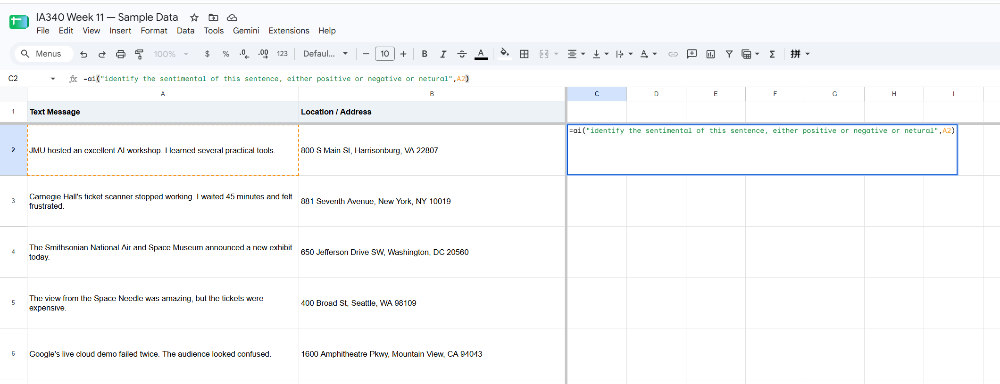<figcaption>Sentiment example: the AI formula reads a message from column A and produces a classification.</figcaption></figure>

**Google AI Pro and eligible Workspace accounts may have access; availability varies.** If unavailable, just watch. No purchase, submission, or grade.

---

## 07 · Optional · extract latitude and longitude

The input may also be a **place or address**, not just a text message. Use the address in column B as context and ask the AI function to estimate one numeric coordinate.

<figure class="figure">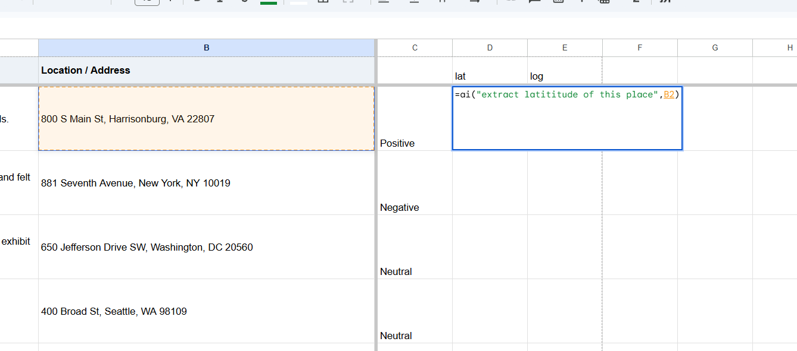<figcaption>Location example: an AI formula reads the address in B2 and estimates a latitude.</figcaption></figure>

**Important:** A generated coordinate is an approximation, not geocoding ground truth. It needs validation before geographic analysis.

---

## 08 · Optional · look at the generated results

After generating a few cells, inspect whether the output is consistent. Do all latitude values use the same decimal-degree format? Are there any values in degrees-minutes-seconds?

<figure class="figure">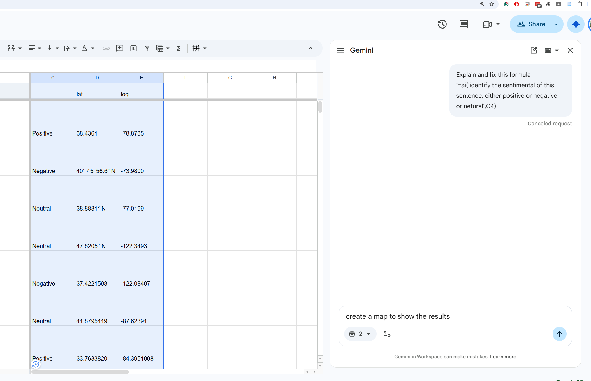<figcaption>Sample results: sentiment labels and latitude/longitude estimates. Some coordinates are formatted inconsistently.</figcaption></figure>

**Discussion:** A tidy spreadsheet does not guarantee accurate coordinates. Validate or convert inconsistent formats before mapping.

---

## 09 · Optional · Gemini-created geospatial map

Gemini can also use the spreadsheet's analysis results to create a **map-style visualization**. This example is an AI-generated view of the ten sample places, colored by sentiment.

<figure class="figure">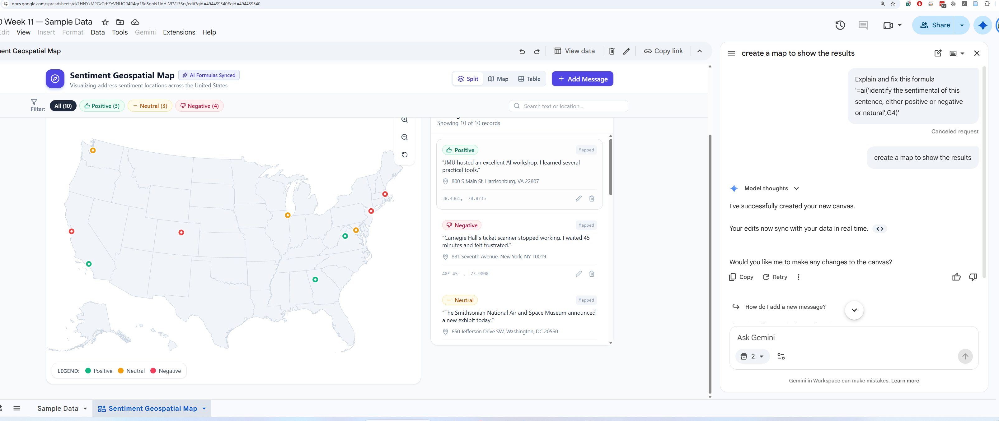<figcaption>Instructor example: Gemini-generated geospatial map with sentiment categories and a row-by-row results panel.</figcaption></figure>

This demonstrates how structured output can support visualization. **It is a Gemini-generated view, not a verified GIS map**; inspect the addresses, coordinates, labels, and category counts before relying on it.

---

## 10 · What does the Gemini LLM API do?

An **API (Application Programming Interface)** lets **Python** send the prompt and context to Gemini, then receive the response.

<figure class="figure"><svg viewBox="0 0 1080 290" role="img" aria-label="Colab Python sends a request with prompt and text over the Gemini LLM API, then receives a response"><defs><marker id="arr-a" markerWidth="12" markerHeight="12" refX="10" refY="5" orient="auto"><path d="M0 0L12 5L0 10Z" fill="#3d9587"/></marker></defs><rect width="1080" height="290" rx="25" fill="#fffaf2"/><rect x="30" y="70" width="263" height="156" rx="18" fill="#e8f2fe"/><text x="161" y="112" font-size="23" text-anchor="middle" fill="#335f92" font-weight="700">COLAB · PYTHON</text><text x="161" y="151" text-anchor="middle" font-size="21" fill="#335f92">prompt + tweet text</text><text x="161" y="187" text-anchor="middle" font-size="18" fill="#5e83a8">send a request</text><rect x="395" y="96" width="286" height="103" rx="45" fill="#e6f6ec" stroke="#8bc6af" stroke-width="3"/><text x="538" y="138" text-anchor="middle" font-weight="700" font-size="24" fill="#19624f">Gemini LLM API</text><text x="538" y="170" text-anchor="middle" font-size="17" fill="#276f5e">a way to ask the model</text><rect x="794" y="70" width="255" height="156" rx="18" fill="#f1eafd"/><text x="921" y="112" font-size="23" text-anchor="middle" fill="#7657a8" font-weight="700">GEMINI MODEL</text><text x="921" y="149" font-size="20" text-anchor="middle" fill="#7657a8">reads your context</text><text x="921" y="182" font-size="18" text-anchor="middle" fill="#8068a4">generates output</text><path d="M295 123 L386 123" stroke="#3d9587" stroke-width="5" marker-end="url(#arr-a)"/><path d="M684 123 L783 123" stroke="#3d9587" stroke-width="5" marker-end="url(#arr-a)"/><path d="M793 214 C662 267 425 267 296 214" stroke="#db8f5f" stroke-width="5" fill="none" marker-end="url(#arr-a)"/><text x="542" y="270" font-size="18" text-anchor="middle" fill="#b56b42">response.text comes back to Python</text><text x="36" y="39" font-size="22" font-weight="700" fill="#174d43">API = Application Programming Interface</text></svg><figcaption>Python sends the prompt and context. Gemini returns the answer; Python decides what to save and draw.</figcaption></figure>

Python—not Gemini—reads our MongoDB collection and decides what to write back to MongoDB.

---

## 11 · Our workflow: read, analyze, save, query, chart

<figure class="figure"><svg viewBox="0 0 1060 400" role="img" aria-label="Read existing Lab 8 tweets, analyze them with Gemini, save fields in the same documents, query the saved results, then create pandas DataFrames and charts."><defs><marker id="arr-query-flow" markerWidth="10" markerHeight="10" refX="9" refY="5" orient="auto"><path d="M0 0L10 5L0 10Z" fill="#287f72"/></marker></defs><rect width="1060" height="400" rx="24" fill="#fffaf2"/><g text-anchor="middle" font-family="sans-serif"><rect x="35" y="45" width="280" height="112" rx="19" fill="#e1f2e9"/><text x="175" y="84" fill="#215c4d" font-size="22" font-weight="700">Read Lab 8 tweets</text><text x="175" y="119" fill="#326c5c" font-size="18">lab8.tweet_collection</text><rect x="390" y="45" width="280" height="112" rx="19" fill="#e8f1fd"/><text x="530" y="84" fill="#335f92" font-size="22" font-weight="700">Python: tweet_data</text><text x="530" y="119" fill="#335f92" font-size="18">tweet IDs + text</text><rect x="745" y="45" width="280" height="112" rx="19" fill="#eee7fc"/><text x="885" y="84" fill="#6d54a6" font-size="22" font-weight="700">Gemini LLM API</text><text x="885" y="119" fill="#6d54a6" font-size="18">analyze the text</text><rect x="745" y="259" width="280" height="112" rx="19" fill="#e1f2e9"/><text x="885" y="298" fill="#215c4d" font-size="22" font-weight="700">Write: $set fields</text><text x="885" y="333" fill="#326c5c" font-size="18">same original tweets</text><rect x="390" y="259" width="280" height="112" rx="19" fill="#e8f1fd"/><text x="530" y="298" fill="#335f92" font-size="22" font-weight="700">Query saved results</text><text x="530" y="333" fill="#335f92" font-size="18">MongoDB AI → export Python</text><rect x="35" y="259" width="280" height="112" rx="19" fill="#ffecd9"/><text x="175" y="298" fill="#98602e" font-size="22" font-weight="700">pandas + charts</text><text x="175" y="333" fill="#98602e" font-size="18">use the query results</text></g><g stroke="#287f72" stroke-width="4" fill="none" marker-end="url(#arr-query-flow)"><path d="M320 101H380"/><path d="M675 101H735"/><path d="M885 162V249"/><path d="M740 315H680"/><path d="M385 315H325"/></g><text x="530" y="211" text-anchor="middle" fill="#536d61" font-size="20">Complete the analysis and writes before querying for charts.</text></svg><figcaption>Reuse the database skills from earlier labs: retrieve documents, update fields, and query the saved values.</figcaption></figure>

We will use the **same `lab8.tweet_collection`**. No new Twitter collection or database is required.

---

## 12 · Model providers and model choices

Examples of LLM providers include **Google (Gemini)**, **OpenAI**, **Anthropic (Claude)**, and **Moonshot AI (Kimi)**. Some models are hosted services; some releases offer downloadable weights under their licenses.

| What differs? | Why it matters |
|---|---|
| Reasoning and response quality | Harder tasks may need a stronger model. |
| Context / token limits | Longer text requires a model that can accept it. |
| Speed and API price | More capable models may be slower or more expensive. Check actual model pricing. |

Our course uses Gemini because of the Google teaching environment and available credits. **Google AI Pro for Sheets and the Gemini LLM API have different access and billing arrangements.**

---

## 13 · Google Cloud · Enable Agent Platform API

**First, select the Google Cloud project** you intend to use. In **APIs & Services → Library**, search for **Agent Platform API**, open its product page, and click **Enable** if it is not already enabled.

<figure class="figure">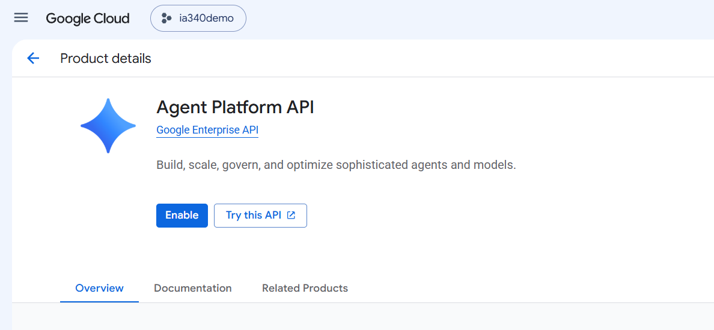<figcaption>Google Cloud API Library: select Agent Platform API and click Enable in the correct project.</figcaption></figure>

Use the **Gemini Enterprise Agent Platform** route shown here. The project must be permitted to use the service, subject to its quota and billing settings.

---

## 14 · Google Cloud · Open Agent Platform

After enabling the API, open **Agent Platform** in Google Cloud. For the classroom API-key workflow, locate **Authenticate** and choose the **API Key** setup option.

<figure class="figure">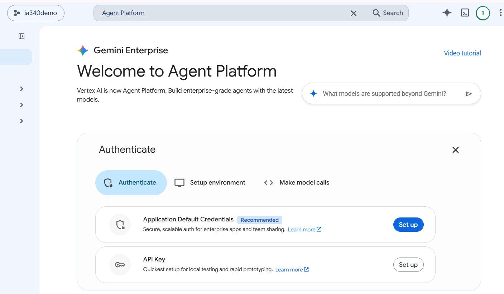<figcaption>Agent Platform: Authenticate offers an API Key option for quick testing, alongside Application Default Credentials.</figcaption></figure>

Google also offers Application Default Credentials for production use. **For this Colab demonstration, follow the API-key path shown here.**

---

## 15 · Google Cloud · Create your Agent Platform key

In the Agent Platform API-key setup screen, choose **Create API Key**. Copy the newly created key into your private Colab Secrets panel; do not put the key into Python cells, screenshots, or GitHub.

<figure class="figure">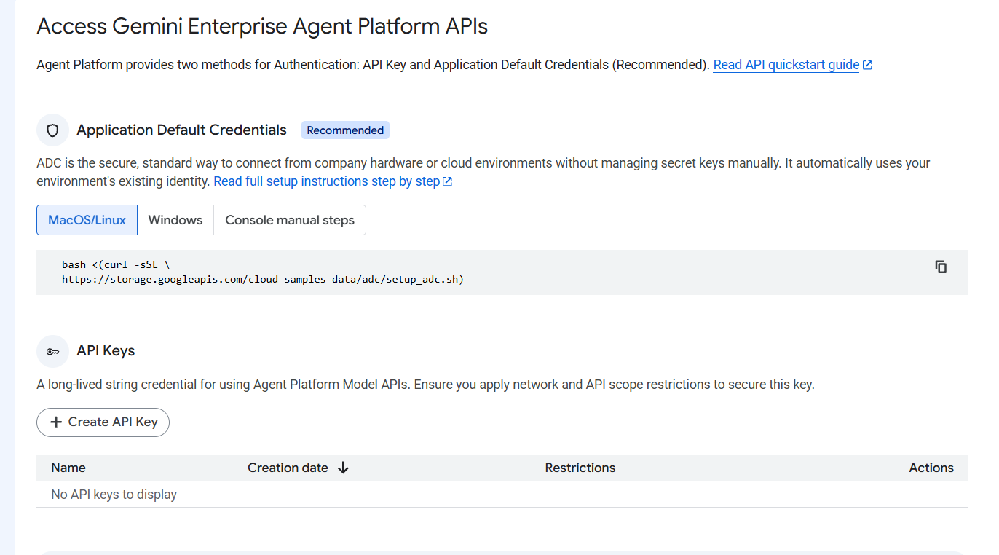<figcaption>Gemini Enterprise Agent Platform: API Keys section with Create API Key button.</figcaption></figure>

Check that your Cloud project, API access, and quota correspond to the key you created.

---

## 16 · Colab Secrets · GOOGLE_CLOUD_API_KEY

In Colab, open the **Secrets** panel (key icon), add these two secrets, and enable **Notebook access** for them:

- `GOOGLE_CLOUD_API_KEY` — the Agent Platform API key you just created.
- `MONGODB_CONNECTION_STRING` — your existing MongoDB connection string.

<figure class="figure">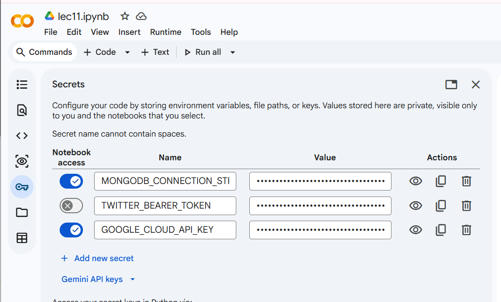<figcaption>Colab Secrets: GOOGLE_CLOUD_API_KEY and MONGODB_CONNECTION_STRING with key values hidden.</figcaption></figure>

The **Secret name must match the Python code exactly**. Keep the value private. No `GEMINI_API_KEY` variable is used in this lecture.

---

## 17 · Install and import

**Colab Cells 1–2.** Install only the packages needed for the LLM and MongoDB connection. The code is the primary classroom example.

```python
%pip -q install google-genai pymongo

from google.colab import userdata
from google import genai
from pymongo import MongoClient
import pandas as pd
import matplotlib.pyplot as plt
import json
from tqdm.auto import tqdm  # Progress bar for long loops
```


**Code explained — Python setup:** **`%pip install`:** gets the Gemini and MongoDB packages. **`import`:** makes each library available; `tqdm` is the progress bar used in the later loops.

<div class="verify-results"><div class="verify-label">Verify the result against these instructor screenshots · click to enlarge</div><div class="verify-gallery"><figure class="verify-shot">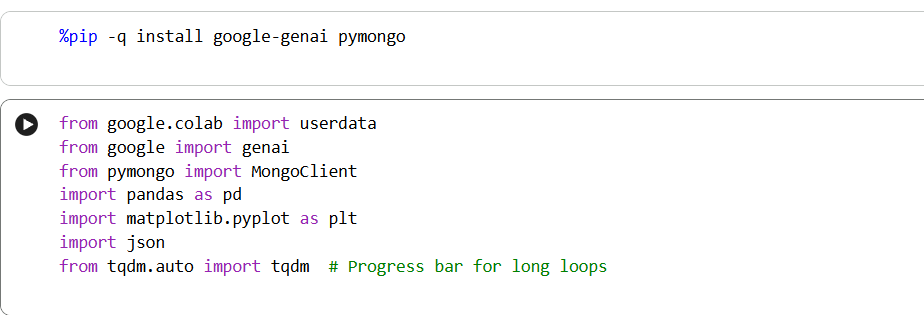<figcaption>Instructor verification: installation and imports completed successfully.</figcaption></figure></div></div>

---

## 18 · Connect to Gemini and test one question

**Colab Cell 3.** The tested Enterprise client uses `GOOGLE_CLOUD_API_KEY` from Colab Secrets.

```python
gemini = genai.Client(enterprise=True, api_key=userdata.get("GOOGLE_CLOUD_API_KEY"))
model = "gemini-3.5-flash-lite"
response = gemini.models.generate_content(
    model=model,
    contents="What is a large language model? Explain in one sentence."
)
print(response.text)
```


**Code explained — Python calls the Gemini API:** **`genai.Client(...)`:** connects using the Cloud API key stored in Secrets. **`generate_content()`:** sends the question; `response.text` is the text returned by Gemini.

<div class="verify-results"><div class="verify-label">Verify the result against these instructor screenshots · click to enlarge</div><div class="verify-gallery"><figure class="verify-shot">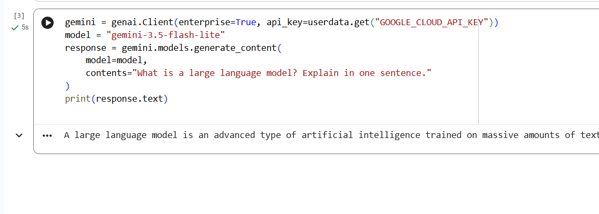<figcaption>Instructor verification: Gemini returned a response in Colab.</figcaption></figure></div></div>

---

## 19 · Add tweet text as context

**Colab Cell 4.** Insert the text in the prompt with a simple Python f-string.

```python
text = "The city launched new buses. Riders praise them but report delays."
prompt = f"What concern do riders report? Use only this text: {text}"
response = gemini.models.generate_content(model=model, contents=prompt)
print(response.text)
```


**Code explained — Python builds a prompt:** **`text`:** is the example context Gemini should read. **`prompt = f"...{text}"`:** combines an instruction with that text; `generate_content()` asks Gemini to answer.

<div class="verify-results"><div class="verify-label">Verify the result against these instructor screenshots · click to enlarge</div><div class="verify-gallery"><figure class="verify-shot">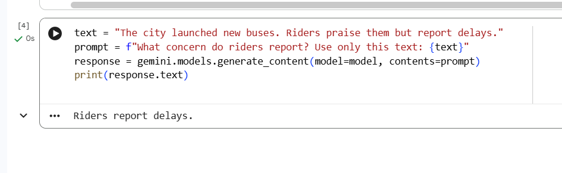<figcaption>Instructor verification: Gemini answered the question about the given text.</figcaption></figure></div></div>

---

## 20 · Reuse one Gemini helper

**Colab Cell 5.** Plain-text tasks use `gemini_help(prompt)`; People uses `gemini_help(prompt, json_list=True)` for a JSON list.

```python
def gemini_help(prompt, json_list=False):
    # Force a JSON list when extracting people; ordinary tasks return plain text.
    config = {"response_mime_type": "application/json", "response_schema": list[str]} if json_list else None
    response = gemini.models.generate_content(model=model, contents=prompt, config=config)
    if not response.text:
        raise ValueError("Gemini returned an empty response")
    return response.text.strip()
```


**Code explained — Reusable Python helper:** **`def gemini_help(prompt)`:** creates a shortcut for repeated Gemini API requests. **`json_list=True`:** requests a JSON list for People; other tasks return ordinary text; an empty response raises an error.

<div class="verify-results"><div class="verify-label">Verify the result against these instructor screenshots · click to enlarge</div><div class="verify-gallery"><figure class="verify-shot">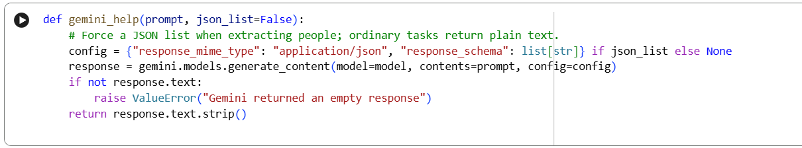<figcaption>Instructor verification: this same helper appears in the working Colab notebook.</figcaption></figure></div></div>

---

## 21 · Read Lab 8 tweets from MongoDB

**Colab Cell 6.** Use the existing MongoDB `client` and the familiar `filter / project / find()` workflow.

```python
client = MongoClient(userdata.get("MONGODB_CONNECTION_STRING"))
tweet_collection = client["lab8"]["tweet_collection"]

filter = {}
project = {"tweet.id": 1, "tweet.text": 1, "_id": 0}
results = client["lab8"]["tweet_collection"].find(
    filter=filter, projection=project
)
```


**Code explained — Python reads MongoDB:** **`filter = {}`:** requests all tweets; `project` selects the ID and text and excludes `_id`. **`find()`:** returns a MongoDB cursor, not a pandas table yet.

<div class="verify-results"><div class="verify-label">Verify the result against these instructor screenshots · click to enlarge</div><div class="verify-gallery"><figure class="verify-shot">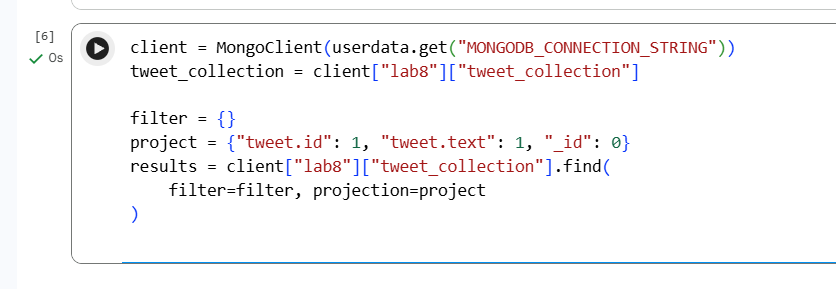<figcaption>Instructor verification: the MongoDB query reads original tweet IDs and text.</figcaption></figure></div></div>

---

## 22 · Create tweet_data once

**Colab Cell 7.** Convert the cursor into records and keep tweet IDs and text in a reusable list.

```python
records = list(results)
tweet_data = []
for record in records:
    tweet_data.append({
        "tweet_id": record["tweet"]["id"],
        "tweet_text": record["tweet"]["text"]
    })
print("Number of tweets:", len(tweet_data))
```


**Code explained — Python prepares reusable data:** **`list(results)`:** reads the MongoDB cursor once into Python records. **`tweet_data.append(...)`:** stores each tweet ID and text together, ready for the next three analyses.

<div class="verify-results"><div class="verify-label">Verify the result against these instructor screenshots · click to enlarge</div><div class="verify-gallery"><figure class="verify-shot">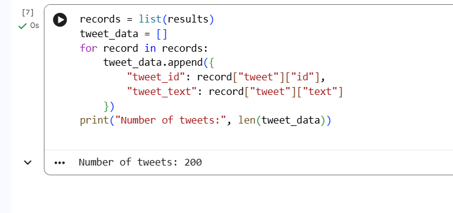<figcaption>Instructor verification: 200 tweets were loaded in this example; your total may differ.</figcaption></figure></div></div>

**Remember:** After `list(results)`, the cursor has been consumed. Rerun the query cell if you need to fetch the records again.

---

## 23 · Sentiment analysis — run the full code

**Colab Cell 8.** Classify each tweet as **Positive, Neutral, or Negative**, then update `tweet.sentiment` in the same document. The progress bar shows completed iterations and `try/except` records failures.

```python
for tweet in tqdm(tweet_data):
    try:
        prompt = f"Classify this tweet as Positive, Neutral, or Negative. Return only the label. Tweet: {tweet['tweet_text']}"
        sentiment = gemini_help(prompt)
        tweet_collection.update_one(
            {"tweet.id": tweet["tweet_id"]},
            {"$set": {"tweet.sentiment": sentiment}}
        )
    except Exception as e:
        print(f"Skipped sentiment for tweet {tweet['tweet_id']}: {e}")
```


**Code explained — Gemini analyzes; Python saves:** **`tqdm(tweet_data)`:** shows the number of tweets processed; no extra student input. **`prompt` / `gemini_help()`:** ask Gemini to classify the current tweet; `$set` writes `tweet.sentiment`. **`try/except`:** reports a failed tweet and continues without writing a false result.

<div class="verify-results"><div class="verify-label">Verify the result against these instructor screenshots · click to enlarge</div><div class="verify-gallery"><figure class="verify-shot">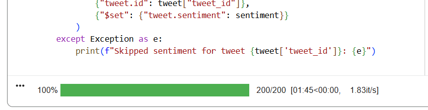<figcaption>Sentiment loop completed: 200/200 on the instructor dataset.</figcaption></figure><figure class="verify-shot">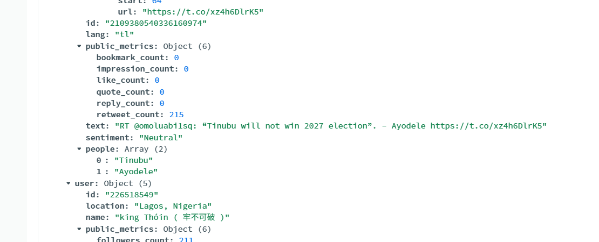<figcaption>MongoDB verification: the original tweet now contains saved sentiment (and a people list).</figcaption></figure></div></div>

**Check:** A visible progress bar is not proof every write succeeded. Inspect messages and the new field in MongoDB.

---

## 24 · Extract people — save a JSON list

**Colab Cell 9.** People must be a list, for example `['Maria', 'Alex']`; `[]` means the text has no named person. A parsing/API failure is reported and skipped.

```python
for tweet in tqdm(tweet_data):
    try:
        prompt = f"Extract every person explicitly named in this tweet. Use [] when none. Tweet: {tweet['tweet_text']}"
        people = json.loads(gemini_help(prompt, json_list=True))
        tweet_collection.update_one(
            {"tweet.id": tweet["tweet_id"]},
            {"$set": {"tweet.people": people}}
        )
    except Exception as e:
        print(f"Skipped people for tweet {tweet['tweet_id']}: {e}")
```


**Code explained — Gemini returns a list; Python saves:** **`prompt`:** asks for all person names in the current tweet, or an empty list. **`json.loads()`:** converts Gemini’s JSON text into a real Python list; `$set` saves `tweet.people`. **`except`:** skips a failed request rather than treating it as `[]`.

<div class="verify-results"><div class="verify-label">Verify the result against these instructor screenshots · click to enlarge</div><div class="verify-gallery"><figure class="verify-shot">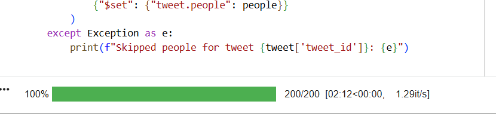<figcaption>People extraction progress in Colab.</figcaption></figure><figure class="verify-shot"><figcaption>MongoDB verification: sentiment label and a people array in the original tweet.</figcaption></figure></div></div>

---

## 25 · Translate tweets — save text

**Colab Cell 10.** You may choose **any** target language by changing `language`. The destination field remains `tweet.translate`.

```python
language = "Chinese"  # Change to any language you prefer.
for tweet in tqdm(tweet_data):
    try:
        prompt = f"Translate this tweet into {language}. Return only the translation. Tweet: {tweet['tweet_text']}"
        translation = gemini_help(prompt)
        tweet_collection.update_one(
            {"tweet.id": tweet["tweet_id"]},
            {"$set": {"tweet.translate": translation}}
        )
    except Exception as e:
        print(f"Skipped translation for tweet {tweet['tweet_id']}: {e}")
```


**Code explained — Gemini translates; Python saves:** **`language`:** selects the translation language; the `prompt` includes that choice and tweet text. **`gemini_help()` / `$set`:** get the translated text and save it as `tweet.translate`.

<div class="verify-results"><div class="verify-label">Verify the result against these instructor screenshots · click to enlarge</div><div class="verify-gallery"><figure class="verify-shot">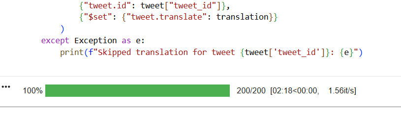<figcaption>Instructor verification: translation loop.</figcaption></figure><figure class="verify-shot">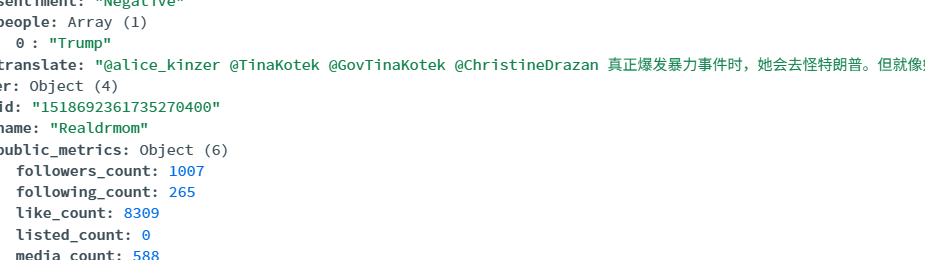<figcaption>MongoDB verification: tweet.translate was written beside the original text.</figcaption></figure></div></div>

---

## 26 · Summarize the whole dataset once

**Colab Cell 11.** Join the texts of all tweets and send **one** request. This is a corpus-level summary—not a separate summary for each tweet.

```python
all_tweets = "\n".join(tweet["tweet_text"] for tweet in tweet_data)
prompt = f"""Summarize the main themes and patterns across all {len(tweet_data)} tweets
in about 150 words. Write ONE overall summary, not a summary of each tweet.
Tweets:
{all_tweets}"""

overall_summary = None
try:
    overall_summary = gemini_help(prompt)
    print(overall_summary)
except Exception as e:
    print("Overall summary failed:", e)
```


**Code explained — One prompt for the whole dataset:** **`"\n".join(...)`:** combines all tweet texts into a single context. **`prompt` / `gemini_help()`:** ask Gemini for ONE overall summary; `print()` displays it without copying it to every tweet.

<div class="verify-results"><div class="verify-label">Verify the result against these instructor screenshots · click to enlarge</div><div class="verify-gallery"><figure class="verify-shot">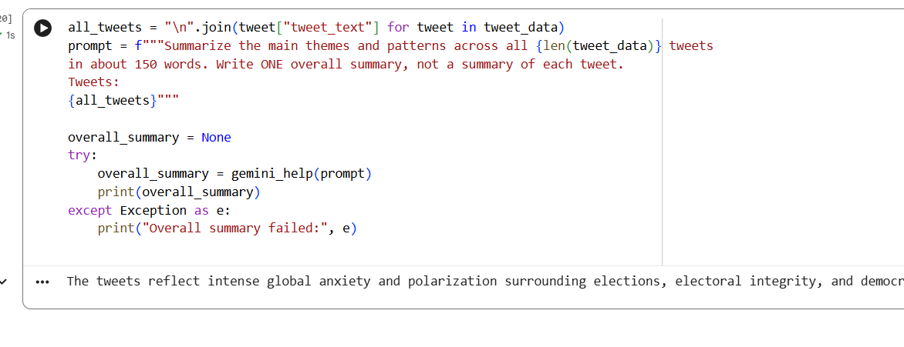<figcaption>Instructor verification: the combined tweets produce one overall summary.</figcaption></figure></div></div>

Review whether the summary reflects the full collection. Larger inputs must fit the selected model's context window.

---

## 27 · Query in MongoDB → result → pandas

**The same process as Lab 10:** Generate your own query in MongoDB, inspect its output, export Python with **Include Driver Syntax**, run it to create `result`, and convert it to pandas.

<div class="mini-path"><span>MongoDB query</span><b>→</b><span>Export Python</span><b>→</b><span>result</span><b>→</b><span>df_posts</span><b>→</b><span>visualization</span></div>

**One reusable Colab cell** works after each exported query:

```python
records = list(result)
df_posts = pd.json_normalize(records)
display(df_posts)
```


**Code explained — MongoDB export → Python DataFrame:** **MongoDB Atlas:** generates the query; exporting with Driver Syntax produces Python `result = ...`. **`list(result)` / `pd.json_normalize()`:** convert those returned records to `df_posts`; `display()` shows the table.

<div class="verify-results"><div class="verify-label">Verify the result against these instructor screenshots · click to enlarge</div><div class="verify-gallery"><figure class="verify-shot">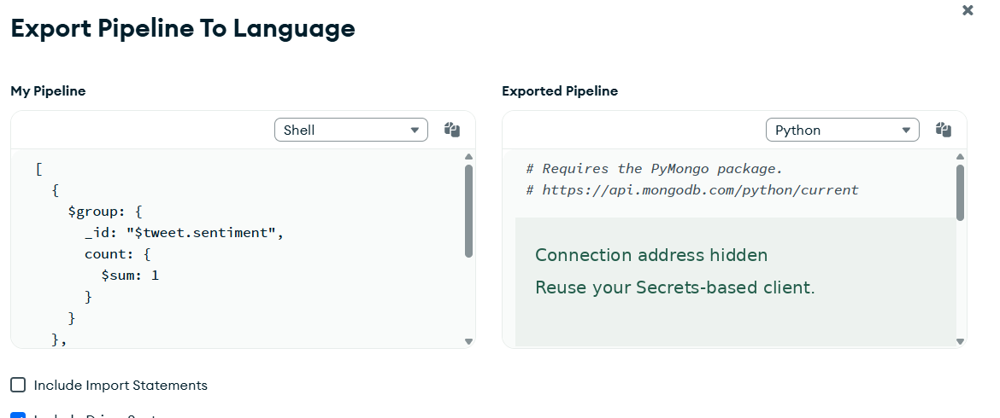<figcaption>MongoDB export: Python with Driver Syntax. Sensitive connection details are masked.</figcaption></figure></div></div>

The **query runs first**. The DataFrame then displays the actual fields returned by that query; do not invent or hardcode column names.

---

## 28 · Sentiment — MongoDB aggregation code

**Instructor-exported query.** In Atlas, generate and run a query that counts the values of `tweet.sentiment`, then export Python. This is the **actual code** from the example notebook, not another backup query.

```python
result = client['lab8']['tweet_collection'].aggregate([
    {
        '$group': {
            '_id': '$tweet.sentiment',
            'count': {
                '$sum': 1
            }
        }
    }, {
        '$sort': {
            'count': -1,
            '_id': 1
        }
    }
])
```


**Code explained — Query code generated in MongoDB Atlas:** **Natural-language request:** “Count the value of different sentiments” generates a MongoDB aggregation. **`$group` / `$sum` / `$sort`:** count tweets per sentiment and sort the results; `result` holds the returned cursor.

<div class="verify-results"><div class="verify-label">Verify the result against these instructor screenshots · click to enlarge</div><div class="verify-gallery"><figure class="verify-shot">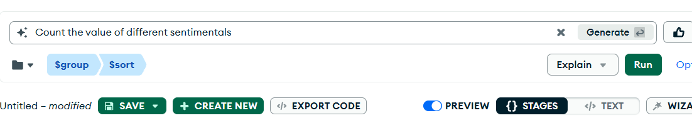<figcaption>MongoDB verification: group sentiment labels and count tweets.</figcaption></figure><figure class="verify-shot">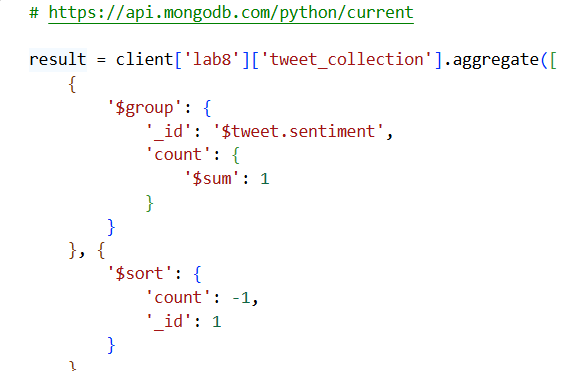<figcaption>Instructor verification: exported query executed in Colab.</figcaption></figure></div></div>


*Instructor screenshot — MongoDB Atlas: a natural-language request generates the Sentiment pipeline.*


---

## 29 · Sentiment — convert result into df_posts

Once the exported query has created `result`, run the **same three-line DataFrame code**:

```python
records = list(result)
df_posts = pd.json_normalize(records)
display(df_posts)
```


**Code explained — Python inspects MongoDB results:** **`result`:** comes from the query on the previous page, not a new Gemini request. **`pd.json_normalize(records)`:** creates `df_posts` with `_id` (sentiment) and `count` for the chart.

<div class="verify-results"><div class="verify-label">Verify the result against these instructor screenshots · click to enlarge</div><div class="verify-gallery"><figure class="verify-shot">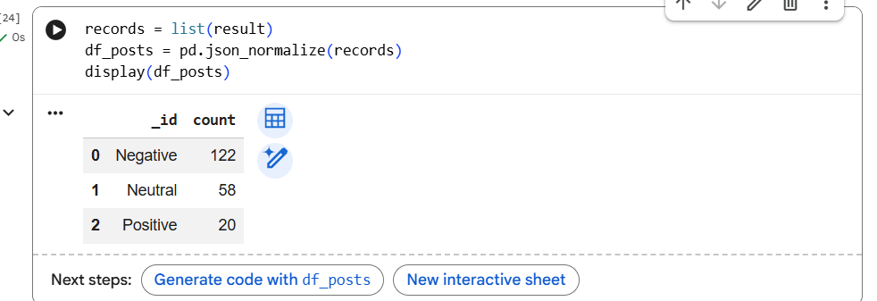<figcaption>Instructor DataFrame: sentiment labels and counts, not three individual tweets.</figcaption></figure></div></div>

Check that `df_posts` has columns such as `_id` and `count` before asking Gemini to draw a chart.


*Instructor screenshot — Gemini in Colab: prompt for a bar chart of `df_posts` (the generated code appears on the next page).*


---

## 30 · Sentiment — chart code generated with Gemini

Ask **Gemini in Colab** to create a bar chart from the DataFrame you just displayed. The instructor's working chart code is shown below; adapt it if your returned columns differ.

```python
import seaborn as sns
import matplotlib.pyplot as plt

# Create a bar chart of the sentiment counts
plt.figure(figsize=(8, 5))
sns.barplot(x='_id', y='count', data=df_posts, palette='viridis', hue='_id', legend=False)
plt.title('Tweet Sentiment Distribution')
plt.xlabel('Sentiment')
plt.ylabel('Number of Tweets')
plt.grid(axis='y', linestyle='--', alpha=0.7)
plt.show()
```


**Code explained — Chart code suggested by Gemini in Colab:** **Gemini in Colab:** uses the displayed `df_posts` as context to suggest chart code. **`sns.barplot(...)`:** draws sentiment labels (`_id`) against tweet totals (`count`); `plt.show()` displays it.

<div class="verify-results"><div class="verify-label">Verify the result against these instructor screenshots · click to enlarge</div><div class="verify-gallery"><figure class="verify-shot">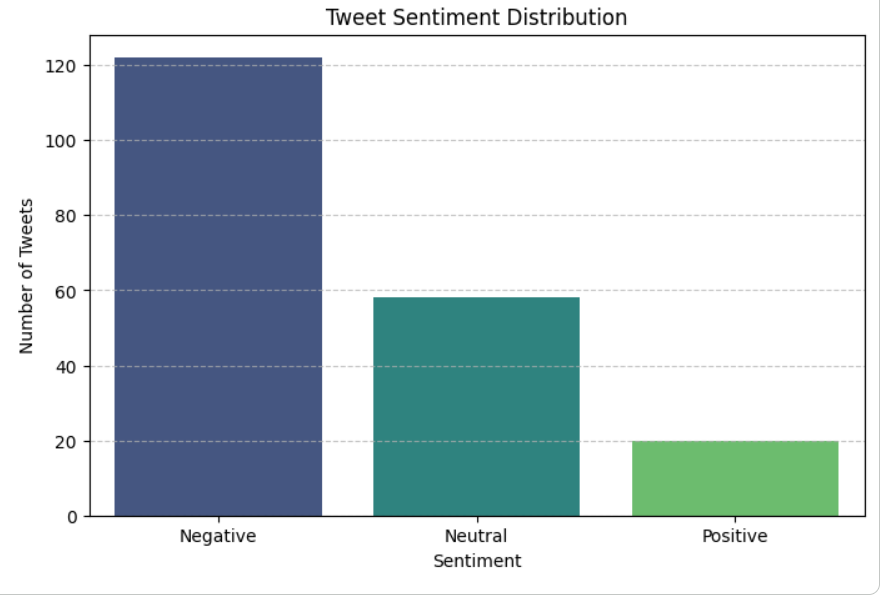<figcaption>Instructor verification: the sentiment bar chart matches the DataFrame counts.</figcaption></figure></div></div>

The bar heights should equal the counts returned by MongoDB. Verify the categories and totals.

---

## 31 · People — MongoDB aggregation code

Ask MongoDB to **unwind `tweet.people`, group names, and count mentions**. This is the actual exported code from the instructor notebook.

```python
result = client['lab8']['tweet_collection'].aggregate([
    {
        '$unwind': '$tweet.people'
    }, {
        '$group': {
            '_id': '$tweet.people',
            'count': {
                '$sum': 1
            }
        }
    }, {
        '$sort': {
            'count': -1,
            '_id': 1
        }
    }
])
```


**Code explained — Query code generated in MongoDB Atlas:** **Natural-language request:** “Count the value of different people in the tweet.people field” creates the pipeline. **`$unwind` / `$group` / `$sort`:** turn list items into names, count mentions, and rank the results.

<div class="verify-results"><div class="verify-label">Verify the result against these instructor screenshots · click to enlarge</div><div class="verify-gallery"><figure class="verify-shot">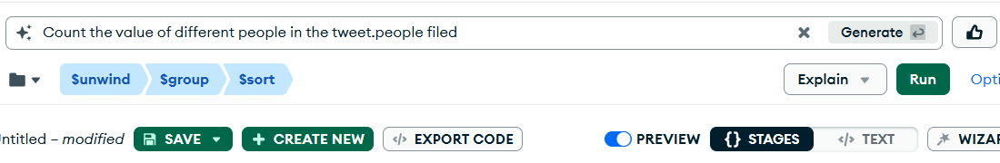<figcaption>MongoDB verification: unwind the people array, group and count names.</figcaption></figure></div></div>


*Instructor screenshot — MongoDB Atlas: a natural-language request generates the People pipeline.*


---

## 32 · People — convert result into df_posts

Run the query above first, then reuse the **exact same three-line conversion**. `df_posts` may be reused after finishing the previous question.

```python
records = list(result)
df_posts = pd.json_normalize(records)
display(df_posts)
```


**Code explained — Python inspects MongoDB results:** **`list(result)`:** collects the people-query results. **`df_posts`:** shows names in `_id` and their mention counts in `count`.

<div class="verify-results"><div class="verify-label">Verify the result against these instructor screenshots · click to enlarge</div><div class="verify-gallery"><figure class="verify-shot">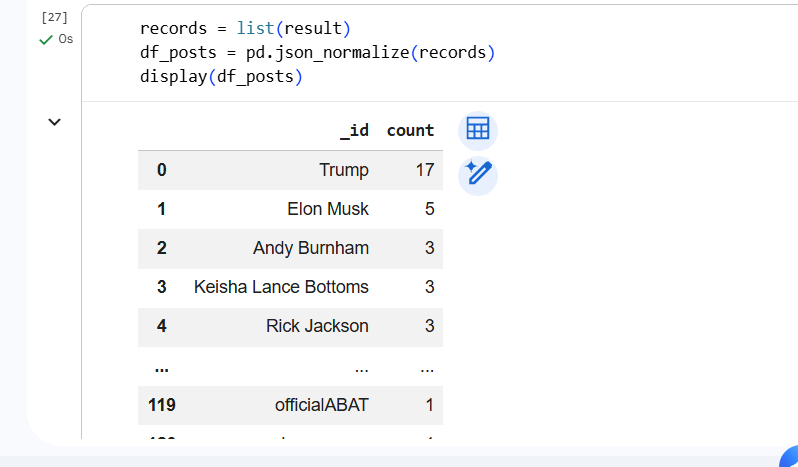<figcaption>Instructor DataFrame: the returned people and mention counts.</figcaption></figure></div></div>

---

## 33 · People — chart code generated with Gemini

Ask Gemini in Colab for a horizontal bar chart of the most-mentioned people. Compare its suggested code and plot with the instructor example below.

```python
import seaborn as sns
import matplotlib.pyplot as plt

# Filter the top 10 most frequently mentioned people for clarity
top_people = df_posts.head(10)

plt.figure(figsize=(12, 6))
sns.barplot(x='count', y='_id', data=top_people, palette='mako', hue='_id', legend=False)
plt.title('Top 10 Most Frequently Mentioned People')
plt.xlabel('Mention Count')
plt.ylabel('Person Name / Handle')
plt.grid(axis='x', linestyle='--', alpha=0.7)
plt.show()
```


**Code explained — Chart code suggested by Gemini in Colab:** **`df_posts.head(10)`:** keeps the ten highest-ranked people. **`sns.barplot(x="count", y="_id", ...)`:** makes a horizontal comparison; the result must match MongoDB counts.

<div class="verify-results"><div class="verify-label">Verify the result against these instructor screenshots · click to enlarge</div><div class="verify-gallery"><figure class="verify-shot">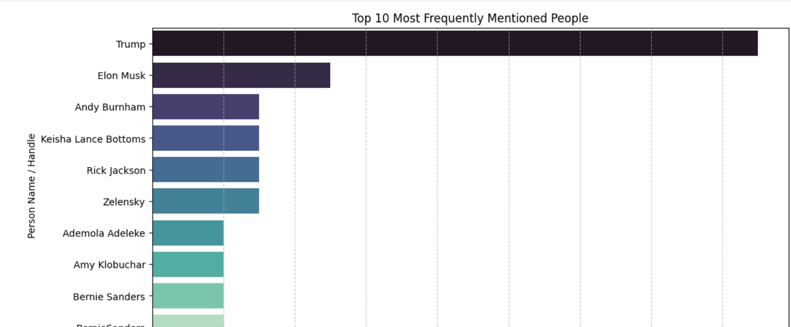<figcaption>Instructor verification: horizontal bar chart of the most-mentioned people.</figcaption></figure></div></div>

A single tweet can mention several people, so total mentions may exceed the number of tweets.

---

## 34 · Translations — MongoDB aggregation code

Use MongoDB to return **the ten most-liked tweets** and their saved translations. Read the text output as a table, rather than counting translation strings.

```python
result = client['lab8']['tweet_collection'].aggregate([
    {
        '$sort': {
            'tweet.public_metrics.like_count': -1
        }
    }, {
        '$limit': 10
    }, {
        '$project': {
            '_id': 0,
            'tweet.public_metrics.like_count': 1,
            'tweet.translate': 1
        }
    }
])
```


**Code explained — Query code generated in MongoDB Atlas:** **Natural-language request:** “Show the translation of the tweets with the top 10 most likes”. **`$sort` / `$limit` / `$project`:** choose the most-liked tweets and return only requested fields.

<div class="verify-results"><div class="verify-label">Verify the result against these instructor screenshots · click to enlarge</div><div class="verify-gallery"><figure class="verify-shot">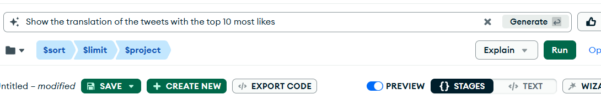<figcaption>MongoDB verification: sort by likes, limit ten, and return translations.</figcaption></figure></div></div>


*Instructor screenshot — MongoDB Atlas: a natural-language request generates the Translation query.*


---

## 35 · Translations — display as a pandas table

Run the exported translation query to produce `result`. Then display the DataFrame:

```python
records = list(result)
df_posts = pd.json_normalize(records)
display(df_posts)
```


**Code explained — Python displays free-text results:** **`result`:** contains the exported MongoDB query’s rows. **`pd.json_normalize` / `display`:** put the saved translations and like counts into a table; no bar chart is needed.

<div class="verify-results"><div class="verify-label">Verify the result against these instructor screenshots · click to enlarge</div><div class="verify-gallery"><figure class="verify-shot">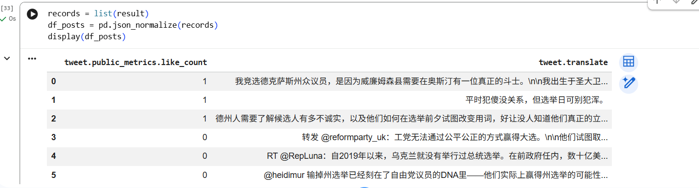<figcaption>Instructor verification: translations and like counts appear in the pandas table.</figcaption></figure></div></div>

No bar chart is needed for individual translations. Check the meaning against the original text.

---

## 36 · Wednesday Lab — repeat with new fields

Use **your own completed `lec11.ipynb`** as the reference. Keep its setup and processing structure, but write your own prompts, query, chart code and explanations.

| Monday Lecture (complete code) | Wednesday Lab (your code) |
|---|---|
| Sentiment → `tweet.sentiment` | Anger → `tweet.anger` |
| People list → `tweet.people` | Organizations list → `tweet.organizations` |
| MongoDB `result` → `df_posts` → chart | Repeat for the two new fields |

**Lab requires two analyses, two queries, two DataFrames and two charts**, plus your Summary and AI Use. No new tweets, no profile-location task and no mandatory Sheets activity.

---

## 37 · Finish and save your Colab notebooks

Your **`lec11.ipynb`** should contain the three saved LLM analysis fields (`sentiment`, `people`, `translate`), **one overall dataset summary**, the executed MongoDB queries, two charts and a translation table. Inspect any failed API calls and keep credentials in Secrets.

Your **`lab11.ipynb`** should adapt the same process to anger and organizations, with query results, charts and your own findings.


```python
client.close()
```


**Code explained — Close the database connection:** **`client.close()`:** ends the MongoDB connection after you finish reviewing and saving your notebook.

**Lecture: 40 points · Lab: 60 points.** The optional Google Sheets demonstration is not graded. See the separate Lab 11 assignment for the complete requirements.

---

## 38 · Check Your Google Cloud Billing Later

Google Cloud Billing reports may take time to show recent Gemini API charges. Check again **the next day or a few days later**, even if today's usage looks empty.

Open **Google Cloud → Billing → Reports** and review the dates, product, usage, and cost. The instructor example shows **$0.26**; your actual charges and reporting delay may differ.

<figure class="figure">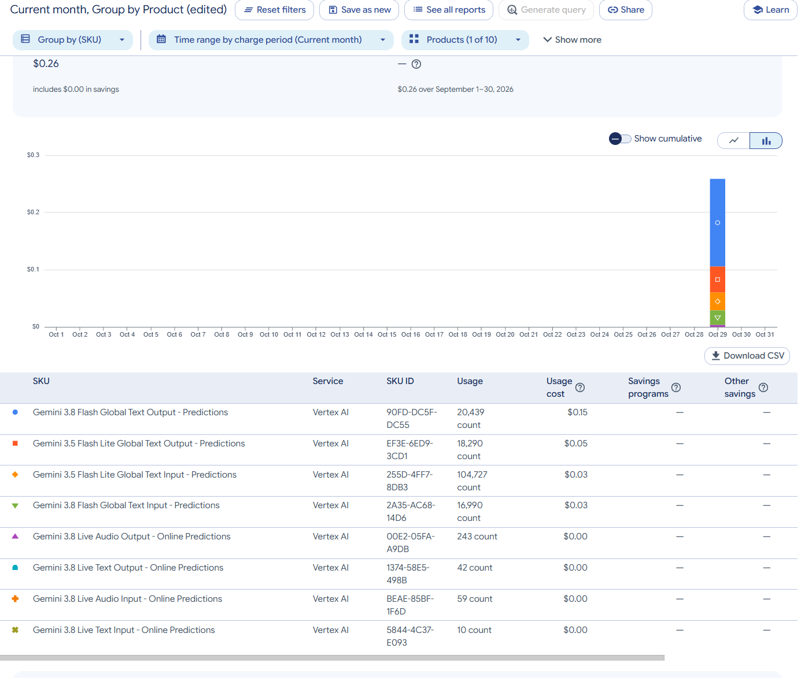<figcaption>Instructor Google Cloud Billing report: example API charges visible after a reporting delay. Costs and timing may differ for your project.</figcaption></figure>
